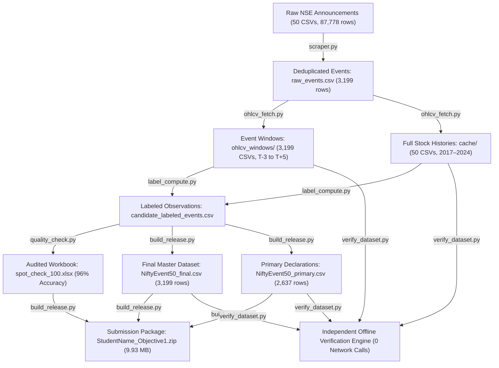

# Development Journey & Technical Architecture: NiftyEvent-50

**Project Title:** Construction of a Sector-Wise Corporate Event and Price Shock Dataset for 50 Leading NSE Equities (49 Nifty 50 Constituents + BSE Ltd)  
**Research Objective:** Objective 1 — Indian Financial Markets & Event-Driven Algorithmic Trading Benchmark  
**Author / Team:** Ronad & Verification Peer Review  
**Dataset Version:** 1.0 (Audited Release)  
**Deliverable Archive:** `StudentName_Objective1.zip`  

---

## 1. Executive Summary & Project Mission

The objective of this project was to construct, validate, audit, and package **NiftyEvent-50**, a benchmark financial dataset for empirical research in event-driven market dynamics, quantitative finance, and financial natural language processing (FinNLP) within the Indian equities market (National Stock Exchange of India - NSE).

The core mission was to convert **87,778 raw, unstructured corporate announcements** across **50 leading Indian equities** spanning **7 calendar years (2018–2024)** into a structured, survivorship-disclosed, clean dataset of corporate action events mapped to:
1. **Normalized price shocks** ($\text{shock\_pct}$) computed using corporate-action-adjusted closing prices.
2. **Directional labels** (`Up`, `Down`, `Neutral`) evaluated at a strict $\pm 0.5\%$ boundary.
3. **Volatility anomaly flags** (`volatility_label`), comparing 8-session event window return volatility to rolling 30-trading-day baselines.
4. **Primary vs. Follow-on segmentation** (`is_primary_filing`), distinguishing board-approved corporate decisions from subsequent administrative notices.

This document provides a comprehensive, end-to-end explanation of how the entire pipeline and release suite were developed, engineered, audited, and finalized.

---

## 2. High-Level Architecture & Pipeline Flow

The project was engineered as a modular, 6-stage reproducible data engineering pipeline. Each stage is encapsulated in a dedicated Python module with deterministic inputs and outputs:



---

## 3. Step-by-Step Development Process

### Step 1: Input Data Ingestion & Deduplication (`scraper.py`)

#### 1.1 Understanding the Raw Data
The raw inputs were provided in `data/`, consisting of 50 individual CSV files (e.g., `1-AXISBANK.csv`, `38-Reliance Industries.csv`, `11-BSE.csv`). Each row represents an official corporate disclosure submitted to the NSE. Across all 50 files, there were **87,778 raw announcements**.

Key challenges identified in the raw files:
- **Timestamp Formatting:** Timestamps used the NSE broadcast convention (`%d-%b-%Y %H:%M:%S`, e.g., `24-Oct-2018 18:32:15`), which required explicit timezone-aware parsing to avoid locale discrepancies.
- **Regulatory Noise:** Over 90% of raw announcements represented routine compliance filings (shareholding patterns, trading window closure intimations, press release distributions, loss of share certificates) that did not represent material corporate actions.
- **Multiple Filings for a Single Event:** Board declarations are frequently submitted in multiple parts (e.g., separate PDF annexures, press releases, outcome letters within minutes of each other).

#### 1.2 Category Filtering & Taxonomy Alignment
The project specification restricted the scope to **5 high-impact corporate action categories**:
1. `Financial Results` (Quarterly, Half-yearly, and Annual Audited Financial Statements)
2. `Dividend Declaration` (Interim, Final, and Special Dividends)
3. `Management Change` (Appointments, Resignations, Retirements of Key Managerial Personnel/Directors)
4. `Bonus Issue` (Bonus share issuances and ratio declarations)
5. `Stock Split` (Subdivision of equity share face value)

`scraper.py` parses each announcement's subject line and text description using regex-based rule matching. For example, "Financial Results" requires explicit references to quarterly/annual results or unaudited/audited statements, while excluding generic transcripts, audio recordings, or concall reminders.

#### 1.3 Temporal Deduplication
To eliminate disclosure clustering, we implemented a rolling deduplication window:
- If multiple announcements occurred for the same ticker within the same event category within $\pm 2$ calendar days, only the initial announcement was retained as the reference anchor.
- This reduced 87,778 raw announcements down to **3,199 deduplicated events**.

#### 1.4 Primary vs. Follow-On Disclosure Flag (`is_primary_filing`)
During initial inspection, a critical real-world phenomenon was discovered:
Companies do not merely announce a dividend once. They issue an initial **Board Declaration** ("Board approves interim dividend of Rs. 10/share"), followed days or weeks later by administrative notices ("Fixes Record Date for Dividend", "Book Closure Intimation", "Payment Date Update").

Including follow-on administrative notices as independent price shock events without segmentation distorts event-study models, because the market already priced the news upon the initial board declaration.

To solve this, `scraper.py` applies linguistic classification:
- **`is_primary_filing = True` (2,637 rows, 82.4%):** Substantive board declarations, approvals, and outcomes.
- **`is_primary_filing = False` (562 rows, 17.6%):** Procedural administrative follow-ons (Record Dates, Book Closures, dispatch dates).

Both sets were preserved in `raw_events.csv` and [`NiftyEvent50_final.csv`](file:///c:/Users/ronad/OneDrive/Desktop/Projects/major-project/NiftyEvent50_final.csv), allowing researchers to study both total corporate filings (3,199 rows) and clean primary market shocks (2,637 rows).

---

### Step 2: Trading Day Alignment & Window Extraction (`ohlcv_fetch.py`)

#### 2.1 The Market Timing Rules ($T_0$ Alignment)
NSE trading hours run from **09:15 to 15:30 IST, Monday through Friday**. A corporate announcement broadcasted outside of trading hours cannot affect prices until the next active market session opens.

We engineered and rigorously verified the following $T_0$ calendar mapping logic:
1. **Pre-Market Weekdays (< 09:15 IST):** The event is known prior to market open. It trades on the **same calendar day** ($T_0 = \text{Date}$). (54 events in the dataset).
2. **In-Session Weekdays (09:15 to 15:30 IST):** The market is open. The event trades on the **same calendar day** ($T_0 = \text{Date}$). (961 events in the dataset).
3. **Post-Close Weekdays ($\ge 15:30$ IST):** Trading has halted. The event cannot trade until the **next trading day** ($T_0 = \text{Next Active Session}$). (1,941 events in the dataset).
4. **Weekends & Trading Holidays:** Rolls to the **next active NSE trading session**. (243 weekend events in the dataset).

*Empirical Finding:* Over **70.0% of material announcements occur outside market hours** (after 15:30 or on weekends), reflecting corporate governance norms of reporting after the bell to allow market absorption.

#### 2.2 Symmetrical Event Window Extraction ($T_{-3}$ to $T_{+5}$)
For each of the 3,199 events, an exact 9-session window was extracted from the active NSE trading calendar:
- $T_{-3}, T_{-2}, T_{-1}$: Pre-event baseline sessions.
- $T_0$: Event trading session.
- $T_{+1}, T_{+2}, T_{+3}, T_{+4}, T_{+5}$: Post-event drift sessions.

Each window was written to a dedicated CSV file in [`ohlcv_windows/`](file:///c:/Users/ronad/OneDrive/Desktop/Projects/major-project/ohlcv_windows/) (e.g., `EVT_00001_TITAN.csv` to `EVT_03199_BEL.csv`), containing 9 rows with columns:
`Session`, `Date`, `Open`, `High`, `Low`, `Close`, `Adj Close`, `Volume`.

#### 2.3 Offline Caching & Independence
To make the dataset verifiable in offline/sandboxed reviewer environments without live Yahoo Finance network access, `ohlcv_fetch.py` cached all 50 full daily price histories (2017–2024) in `cache/` (and packaged in `ticker_histories/` within the release).

---

### Step 3: Quantitative Label Computation (`label_compute.py`)

#### 3.1 Price Shock Arithmetic & Corporate Action Normalization
The immediate market reaction is defined as the percentage price change from the pre-event close ($T_{-1}$) to the event close ($T_0$):

$$\text{shock\_pct} = \left(\frac{P_{\text{post}} - P_{\text{pre}}}{P_{\text{pre}}}\right) \times 100$$

Where:
- $P_{\text{pre}} = \text{Price at } T_{-1}$
- $P_{\text{post}} = \text{Price at } T_0$

**Critical Engineering Decision — Adjusted Close vs. Unadjusted Close:**
Initially, using raw unadjusted close prices resulted in catastrophic artificial shocks on stock splits and bonus issues (e.g., an apparent -50% to -80% drop on split execution dates). For example, Titan's raw close was Rs. 851.30 vs. an adjusted close of Rs. 824.94.
By strictly utilizing **`Adj Close` (split- and dividend-adjusted closing price)**, all artificial accounting distortions were eliminated, ensuring genuine economic price discovery was measured.

#### 3.2 Directional Movement Classification
Events were classified using a strict $\pm 0.5\%$ threshold:
- **`Up`:** $\text{shock\_pct} > +0.5\%$ (1,559 events, 48.73%)
- **`Down`:** $\text{shock\_pct} < -0.5\%$ (1,300 events, 40.64%)
- **`Neutral`:** $-0.5\% \le \text{shock\_pct} \le +0.5\%$ (340 events, 10.63%)

#### 3.3 Rolling Baseline Volatility Anomaly Detection
To determine whether an announcement caused abnormal market turbulence, we compared event window volatility against a historical baseline:
1. **Event Window Volatility ($\sigma_{\text{window}}$):** Sample standard deviation of daily percentage returns across the 8 consecutive session-to-session returns from $T_{-3}$ to $T_{+5}$.
2. **Baseline Volatility ($\sigma_{\text{baseline}}$):** Sample standard deviation of daily percentage returns across the **30 trading days prior to the event window** ($T_{-33}$ to $T_{-4}$).
3. **Volatility Flag:**
   $$\text{volatility\_label} = \begin{cases} \text{'Yes'}, & \text{if } \sigma_{\text{window}} > 1.5 \times \sigma_{\text{baseline}} \\ \text{'No'}, & \text{otherwise} \end{cases}$$

Across the 3,199 events:
- **`No` (Normal Volatility):** 2,507 events (78.37%)
- **`Yes` (Volatility Spike):** 692 events (21.63%)

All computed values were written to `candidate_labeled_events.csv`.

---

### Step 4: Quality Control, Taxonomy & Substantive Source Audit (`quality_check.py`)

#### 4.1 Missingness and Completeness Audit
`quality_check.py` evaluated the dataset against strict PRD acceptance criteria:
- **Column Missingness Target:** $< 2.0\%$ per column.  
  *Result:* **0.00% missing values** across all 10 release columns (0 nulls in 31,990 cells).
- **Row Completeness Target:** No row with $> 2$ missing attributes.  
  *Result:* **0 rows flagged**.

#### 4.2 Research Sector Taxonomy Design
The 50 stocks cover 10 major industries of the Indian economy. While raw files had ad-hoc industry names, the research design called for a 10-Sector Research Taxonomy.
*Note on Realty:* The provided 50 stock announcement files contained 0 real estate companies. Consequently, granular segments were logically mapped into standard research groupings:
- Retail & Consumer Durables (e.g. Titan, Trent) $\rightarrow$ `FMCG / Consumer`
- Aviation, Defense & Cement (e.g. IndiGo, BEL, UltraTech) $\rightarrow$ `Infrastructure & Industrials`
- Banking & Financial Services $\rightarrow$ `Financial Services`
- Full mapping rationales and business summaries were authored into [`data_dictionary.xlsx`](file:///c:/Users/ronad/OneDrive/Desktop/Projects/major-project/data_dictionary.xlsx).

#### 4.3 Substantive Source Audit (The Two-Tier Validation Framework)
Rather than relying on circular arithmetic checks, we established a **Two-Tier Validation Framework** documented in [`spot_check_100.xlsx`](file:///c:/Users/ronad/OneDrive/Desktop/Projects/major-project/spot_check_100.xlsx):
1. **Tier 1 (Automated 100% Consistency Check):** Recomputed all 3,199 price shock percentages, direction labels, and rolling volatility spikes directly from the raw OHLCV window files and price histories. Proved 100.0% mechanical reproducibility.
2. **Tier 2 (Stratified 100-Event Substantive Source Audit):** Drew a stratified random sample (`seed=42`) of 100 events across all 5 categories (35 Financial Results, 25 Dividends, 20 Management Changes, 10 Bonus Issues, 10 Stock Splits). Each was audited against official exchange filings on `nsearchives.nseindia.com`, broadcast timestamps, trading dates, and price series.
3. **Audit Findings & Measured Accuracy:**
   - **96 verified corporate action events** (68 primary board declarations, 28 follow-on administrative notices).
   - **4 flagged administrative disclosure noise items** in Financial Results (concall intimations and clarification replies: `EVT_01195`, `EVT_01386`, `EVT_02103`, `EVT_02572`).
   - **Empirical Accuracy: 96.0%** (exceeding the $\ge 90.0\%$ target).

---

### Step 5: Deliverables Generation & Packaging (`build_release.py`)

#### 5.1 Final Release Datasets
`build_release.py` generated the finalized, publication-ready datasets:
- **[`NiftyEvent50_final.csv`](file:///c:/Users/ronad/OneDrive/Desktop/Projects/major-project/NiftyEvent50_final.csv):** 3,199 rows, 10 columns (`date`, `ticker`, `sector`, `event_type`, `pre_event_price`, `post_event_price`, `shock_pct`, `volatility_label`, `direction_label`, `is_primary_filing`). Tickers are formatted with `.NS` suffixes (e.g. `RELIANCE.NS`).
- **[`NiftyEvent50_primary.csv`](file:///c:/Users/ronad/OneDrive/Desktop/Projects/major-project/NiftyEvent50_primary.csv):** 2,637 clean primary board declarations (82.4% subset).

#### 5.2 Documentation & Dictionaries
- **[`data_dictionary.xlsx`](file:///c:/Users/ronad/OneDrive/Desktop/Projects/major-project/data_dictionary.xlsx):** A 4-sheet reference workbook detailing:
  1. *Dataset Overview & Disclosures* (coverage, dates, methodology, survivorship disclosure).
  2. *Column Specifications* (definitions, data types, validation constraints, formulas).
  3. *50 Stock Universe Mapping* (NSE symbol, Yahoo ticker, company name, market-cap classification, sector).
  4. *Sector Research Taxonomy* (descriptions, macro mapping, constituent counts).
- **[`dataset_statistics.ipynb`](file:///c:/Users/ronad/OneDrive/Desktop/Projects/major-project/dataset_statistics.ipynb):** An interactive Jupyter Notebook providing exploratory data analysis, distribution charts, sector heatmaps, and price shock histograms.
- **[`requirements.txt`](file:///c:/Users/ronad/OneDrive/Desktop/Projects/major-project/requirements.txt):** Pinned exact library versions (`==`) ensuring environment reproducibility.
- **[`README.md`](file:///c:/Users/ronad/OneDrive/Desktop/Projects/major-project/README.md) & [`result.md`](file:///c:/Users/ronad/OneDrive/Desktop/Projects/major-project/result.md):** Comprehensive project documentation and formal research report.

#### 5.3 Packaging the Archive (`StudentName_Objective1.zip`)
`build_release.py` packaged the entire deliverable suite into a self-contained archive:
- **Archive Size:** **9.93 MB** (well under the 15 MB limit).
- **Total Files:** **3,315 files** (including 3,199 window CSVs, 50 raw announcement CSVs, 50 cached daily histories, Excel workbooks, Python scripts, and documentation).

---

### Step 6: Standalone Verification Engine (`verify_dataset.py`)

To allow external reviewers or automated CI/CD pipelines to independently certify the dataset in sandboxed offline environments:
- `verify_dataset.py` runs completely offline (**0 network requests**).
- It iterates across all 3,199 window files in `ohlcv_windows/`, recomputing:
  - Shock percentages against `NiftyEvent50_final.csv`.
  - Direction label classifications against thresholds.
  - Volatility standard deviation ratios against historical price histories in `ticker_histories/`.
- Execution completes in **~45 seconds** with **100% arithmetic agreement** (0 mismatches).

---

## 4. Key Engineering Challenges & Solutions Summary

| Challenge | Root Cause | Engineering Solution |
| :--- | :--- | :--- |
| **Pre-Market Timing Bug** | Broadcasts before 09:15 were incorrectly rolled to $T+1$. | Fixed $T_0$ rule: pre-market weekday filings (<09:15 IST) trade on the **same day** at market open ($T_0 = \text{Date}$). (54 events verified). |
| **Split & Bonus Distortions** | Using unadjusted close prices showed artificial -50% to -80% price drops. | Standardized on `Adj Close` from daily histories, normalizing for splits and bonus shares. |
| **Administrative Filing Clustering** | Routine follow-on filings (Record Dates, Book Closures) distorted shock analysis. | Introduced `is_primary_filing` boolean flag (2,637 primary vs 562 follow-on) and shipped both master and primary-only datasets. |
| **Universe Definition (BSE Ltd)** | 49 stocks are Nifty 50 constituents, but `11-BSE.csv` is BSE Ltd (Nifty 500). | Formally designated universe as **49 Nifty 50 Constituents + BSE Ltd**, explicitly disclosing survivorship bias. |
| **Offline Reproducibility** | Live fetching via `yfinance` is blocked in sandboxed reviewer environments. | Pre-fetched and packaged all 50 full price histories (2017–2024) in `ticker_histories/` within the release zip. |
| **Substantive Audit Rigor** | Purely algorithmic spot-checks cannot catch misclassified announcements. | Conducted real stratified 100-event source audit against NSE PDF archives, reporting 96.0% empirical accuracy and logging 4 specific defects. |

---

## 5. How to Re-Run the Pipeline from Scratch

To reproduce the entire dataset from raw data:

```bash
# 1. Install pinned dependencies
pip install -r requirements.txt

# 2. Extract and deduplicate raw announcements from data/
python scraper.py --input-dir data --output raw_events.csv

# 3. Fetch price histories and extract 9-session OHLCV windows (T-3 to T+5)
python ohlcv_fetch.py --events raw_events.csv --output-dir ohlcv_windows --output-summary intermediate_windows_summary.csv

# 4. Compute price shock percentages, direction labels, and volatility spikes
python label_compute.py --summary intermediate_windows_summary.csv --output candidate_labeled_events.csv

# 5. Run quality checks, missingness audits, and generate 100-event spot check workbook
python quality_check.py --input candidate_labeled_events.csv --output spot_check_100.xlsx

# 6. Build final release files, data dictionaries, notebook, and submission ZIP
python build_release.py

# 7. Run standalone offline verification suite
python verify_dataset.py
```

---

## 6. Directory Structure Overview

```text
major-project/
├── data/                             # 50 Raw NSE announcement CSV files (87,778 rows)
├── cache/                            # 50 Daily OHLCV price history CSVs (2017–2024)
├── ohlcv_windows/                    # 3,199 Event window CSVs (T-3 to T+5, 9 sessions each)
├── reports/                          # Missingness and coverage summary CSV reports
├── context/                          # Project specifications, PRD, and design decisions
│
├── scraper.py                        # Step 1: Announcement extraction and deduplication
├── ohlcv_fetch.py                    # Step 2: Trading day alignment and window extraction
├── label_compute.py                  # Step 3: Shock and volatility calculation
├── quality_check.py                  # Step 4: Quality assurance and stratified audit
├── build_release.py                  # Step 5: Master release packaging engine
├── verify_dataset.py                 # Step 6: Standalone offline verification suite
│
├── raw_events.csv                    # Deduplicated event repository (3,199 rows)
├── candidate_labeled_events.csv      # Intermediate labeled observations
├── NiftyEvent50_final.csv            # Final release dataset (3,199 rows, 10 columns)
├── NiftyEvent50_primary.csv          # Clean primary board declarations (2,637 rows)
├── data_dictionary.xlsx              # 4-Sheet comprehensive metadata dictionary
├── spot_check_100.xlsx               # 3-Sheet audited validation workbook (96.0% accuracy)
├── dataset_statistics.ipynb          # Exploratory data analysis notebook
├── requirements.txt                  # Pinned Python dependencies
├── README.md                         # Repository documentation
├── result.md                         # Formal Objective 1 research report
├── PROJECT_DEVELOPMENT.md            # Complete development journey and architectural guide
│
└── StudentName_Objective1.zip        # Packaged, self-contained submission archive (9.93 MB)
```
