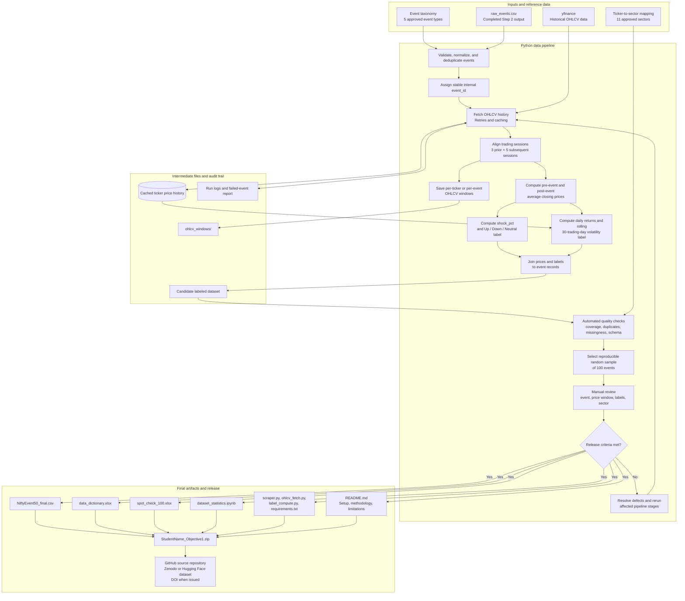

# NiftyEvent-50 Architecture Diagram

This architecture covers the full six-step dataset pipeline, from defining the event taxonomy through publishing the validated dataset. Steps 1 and 2 are marked as existing inputs; the remaining modules complete Steps 3–6.

## Architecture notes

- **Step 1 — Taxonomy:** The approved five event types and their detection rules are a versioned input to the pipeline.
- **Step 2 — Announcements:** `raw_events.csv` is the existing input. Validate and retain provenance where available; do not silently discard source records.
- **Step 3 — OHLCV:** Retrieve historical market data, align events to trading sessions, and persist reusable price history and event windows. The 30-day volatility calculation requires more history than the three-before/five-after event window.
- **Step 4 — Labels:** Calculate the pre/post average close, price shock, direction, and volatility-spike label using explicitly documented methodology settings.
- **Step 5 — Quality:** Map sectors, report row-level and column-level missingness, calculate coverage statistics, and manually review a reproducible random sample of 100 events.
- **Step 6 — Release:** Export the final CSV, data dictionary, validation workbook, statistics notebook, source scripts, and README. Publish only after the release gate; record a DOI only after it has actually been issued.

## Decisions to freeze before a full run

1. Raw `Close` versus adjusted price series, especially for stock splits and bonus issues.
2. The precise historical baseline used for the 1.5x volatility-spike threshold.
3. How announcements on non-trading days or after market close are aligned.
4. Whether the historical universe means current Nifty 50 tickers or historical constituents for each year.
5. The earnings-surprise source and the exact rule for calculating an EPS surprise.

These decisions affect labels and must be documented in the data dictionary and README.
