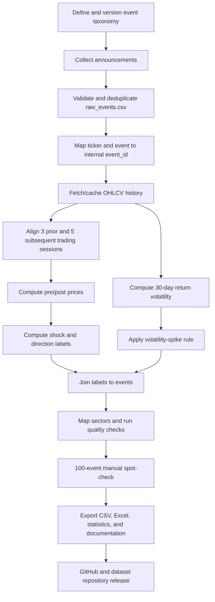

# Product Requirements Document (PRD)

## NiftyEvent-50: Sector-Wise Corporate Event and Price Shock Dataset for Nifty 50 Stocks

**Document version:** 1.0  
**Status:** Implementation-ready draft; confirm the open methodology decisions before the full run  
**Project period:** 2018–2024  
**Delivery window:** 3 days for the remaining implementation and release  
**Team size:** 4 members  
**Primary language:** Python  
**Primary output:** Reproducible, labeled event dataset in CSV and Excel-compatible formats

---

## 1. Executive Summary

NiftyEvent-50 is a reproducible data pipeline that links corporate announcements for Nifty 50 stocks to historical market-price behavior. It will collect five types of corporate events, align each event with a pre-event and post-event OHLCV window, calculate price-shock and volatility labels, map each stock to a sector, validate the resulting dataset, and prepare a documented release.

The research design covers Indian equities for 2018–2024 and targets all 50 Nifty 50 companies, 11 specified sectors, five event types, and at least 3,000 labeled events. The resulting dataset is intended to support research and benchmarking of event-based portfolio-risk classifiers. This project is a dataset-construction pipeline; it does not promise trading profitability or make buy/sell recommendations.

**Current project status:** Step 1 (Define Event Taxonomy) and Step 2 (Collect Event Announcements) are reported as completed. Steps 3–6 remain to be completed and integrated with those outputs. The PRD documents all six steps so the finished pipeline is reproducible from raw inputs.

## 2. Problem Statement

Researchers analyzing Indian equities often have to collect and interpret corporate announcements manually. The project aims to provide a consistent dataset in which corporate events are linked to measurable market responses, including both price-shock magnitude/direction and volatility behavior.

The pipeline must make its event definitions, data provenance, calculations, validation results, and release artifacts transparent enough for another researcher to reproduce the dataset.

## 3. Goals and Success Metrics

### 3.1 Goals

1. Standardize the detection and representation of the five approved corporate-event categories.
2. Collect and deduplicate announcements for the target stocks and date range.
3. Align event dates with market trading sessions and retrieve required OHLCV observations.
4. Compute pre-event/post-event prices, price shock, direction, and volatility labels consistently.
5. Validate sector mapping, coverage, missingness, and sampled label correctness.
6. Release the dataset, code, methodology, and documentation.

### 3.2 Success metrics

| Metric | Target from research design | Measurement method |
|---|---:|---|
| Labeled events | At least 3,000 | Number of rows in final dataset that pass required validation |
| Stock coverage | All 50 Nifty 50 companies | Distinct ticker count and coverage report |
| Sector coverage | All 11 named sectors | Distinct sector count and coverage report |
| Event-type coverage | All 5 event types | Distinct event-type count and coverage report |
| Period | 2018–2024 | Minimum and maximum qualifying event dates |
| Manual spot-check accuracy | At least 90% | Correctly verified sampled labels / labels checked; calculation method documented |
| Missingness | Below 2% per column | Missing-value count and percentage for each final column |
| Reproducibility | Pipeline runs from documented inputs and dependencies | Clean-environment run and documented commands |

These are targets, not assumed outcomes. Reports must state measured results even when a target is missed. Do not create artificial rows, infer unavailable prices without disclosure, or report an unearned accuracy score to meet a target.

## 4. Users and Primary Use Cases

### Primary users
- Research team members constructing and validating the dataset.
- Supervisors/researchers reviewing methodology and data quality.
- Future researchers using the published data to benchmark event-driven models.

### Primary use cases
- Rebuild the event dataset from the collected announcements.
- Inspect an event and its aligned market-price window.
- Review its price-shock percentage, direction label, and volatility label.
- Calculate coverage and completeness statistics by stock, sector, event type, and year.
- Reproduce a random manual quality-check sample.
- Download the data and understand its schema, limitations, and provenance.

## 5. Scope

### 5.1 In scope

- Five event types: Dividend Declaration, Bonus Issue, Stock Split, Earnings Surprise (Beat/Miss), and Management Change.
- Announcement collection for 50 Nifty 50 tickers across 2018–2024, using the existing Step 2 output as the starting point.
- OHLCV price retrieval using `yfinance` and `pandas`/`numpy` processing.
- Three trading days before and five trading days after each event for the event-window price summaries.
- Pre-event and post-event average closing prices.
- Price-shock percentage and Up/Down/Neutral direction labels.
- Volatility-spike flag based on rolling 30-trading-day standard deviation of daily returns and a 1.5× comparison threshold.
- Sector mapping to the 11 sectors named in the research design: IT, Banking, Energy, FMCG, Auto, Pharma, Metal, Realty, Telecom, Finance, and Infra.
- Quality checks, random sample of 100 events, CSV/Excel exports, data dictionary, statistics notebook, code, requirements, README, and release preparation.

### 5.2 Out of scope

- A live trading system or investment advice.
- A production real-time market-data service.
- Training a production classifier. The source document lists a baseline classifier as optional and outside the required six-step pipeline.
- Guaranteed DOI issuance before a repository's external review/registration process completes.
- Adding event categories beyond the five approved types without a documented scope change.

## 6. Assumptions and Methodology Decisions

The following must be made explicit in configuration and documentation rather than hidden in code.

1. **Event date definition:** Use the announcement date available in `raw_events.csv`. Preserve the original date. If the announcement occurred on a non-trading day or after a market close, align the price window using the approved trading-calendar rule and record the alignment behavior. Do not silently change the source event date.
2. **Price-window definition:** For an event, use the three available trading sessions before the aligned event session for the pre-event mean and the five available trading sessions after it for the post-event mean. Do not count weekends or exchange holidays as trading sessions.
3. **Missing prices:** Retry transient download failures and use a cached full history per ticker when possible. Do not forward-fill across a long missing segment or use a fabricated price. Any permitted forward-fill must be marked and documented; rows with insufficient valid observations must be flagged or excluded from the final labeled dataset according to a recorded rule.
4. **Price adjustments:** Split and bonus events can cause mechanical changes in quoted price. Before full processing, choose and document whether calculations use raw `Close` or adjusted prices. Use one consistent price convention for all events and state the consequences in the data dictionary. This decision is a release blocker because it can materially change labels.
5. **Volatility baseline:** The source defines a 30-day rolling standard deviation and a 1.5× rolling-average threshold, but does not fully specify the baseline window. Before the full run, document the exact formula and ensure that any comparison baseline uses only information available up to the event time (to avoid look-ahead leakage). Keep the baseline window and threshold configurable.
6. **Earnings surprise detection:** The source gives an example rule of actual EPS versus analyst consensus deviation greater than 5%. Confirm the exact signed/absolute deviation convention and how analyst consensus will be sourced. If the existing event catalog does not contain enough evidence, mark the event for review rather than assume an earnings surprise.
7. **Coverage universe:** The document calls for all 50 Nifty 50 stocks across 2018–2024. Confirm whether the target means the present-day 50 tickers applied to the historical period or historical index constituents at the time of each event. Record the chosen universe definition.
8. **Sector taxonomy:** Use the 11 names specified in the research design. Each ticker must map to exactly one approved sector for the release version. Any taxonomy mismatch requires review.

## 7. Functional Requirements

### Step 1 — Define Event Taxonomy

**Status:** Reported completed. Preserve the definitions as a versioned artifact and verify them before final processing.

| ID | Requirement | Acceptance criteria |
|---|---|---|
| FR-01 | Maintain a controlled list of five event types. | Only the five approved event types can appear in the canonical event dataset. |
| FR-02 | Document detection rules for each event type. | Each type has inclusion rules, exclusions, and an example or review note. |
| FR-03 | Define a master event-record schema. | The schema includes at minimum ticker, announcement date, event type, and brief description; a stable internal event ID is recommended. |
| FR-04 | Version the taxonomy and event rules. | Taxonomy version and rule changes are recorded in the repository. |

Approved event types:
- Dividend Declaration
- Bonus Issue
- Stock Split
- Earnings Surprise (Beat/Miss)
- Management Change

The source mentions the NSE Corporate Announcements Portal and BSE XML feed as tools. Step 2 is described specifically as collecting NSE Corporate Announcements; any BSE records included must be identified by source and deduplicated transparently.

### Step 2 — Collect Event Announcements

**Status:** Reported completed. Reuse `raw_events.csv` and verify it meets these requirements before processing.

| ID | Requirement | Acceptance criteria |
|---|---|---|
| FR-05 | Store raw announcement records. | `raw_events.csv` is present and its columns/types are documented. |
| FR-06 | Capture announcement date, ticker, event type, and description. | Required values are parseable or explicitly flagged as missing. |
| FR-07 | Restrict events to the five approved categories and 2018–2024 period. | Out-of-scope records are excluded from the canonical input with counts logged. |
| FR-08 | Deduplicate same ticker/event pairs within ±2 days, following the existing approved rule. | Duplicate counts and the rule used are reported; source records are not silently overwritten. |
| FR-09 | Preserve data provenance. | Source URL/identifier and collection timestamp are preserved when available; limitations are stated if the existing file lacks them. |

### Step 3 — Fetch OHLCV Price Windows

**Owner:** Member A — Market Data Engineer

| ID | Requirement | Acceptance criteria |
|---|---|---|
| FR-10 | Fetch OHLCV data for each event's ticker using `yfinance`. | Data includes available Open, High, Low, Close, and Volume observations for the required windows. |
| FR-11 | Align each event with three prior and five subsequent trading sessions. | Every event has an explicit alignment result and no weekend/holiday is mistaken for a trading session. |
| FR-12 | Calculate the pre-event baseline. | `pre_event_price` is the mean of the three eligible pre-event closing prices when all required values are available, unless the documented missing-data rule explicitly allows otherwise. |
| FR-13 | Calculate the post-event price. | `post_event_price` is the mean of the five eligible post-event closing prices when all required values are available, subject to the documented missing-data rule. |
| FR-14 | Handle retrieval failures and missing data. | Use bounded retries, log failures, cache downloaded history, and expose missing-window counts. |
| FR-15 | Save raw window observations. | `ohlcv_windows/` contains per-ticker or per-event files with dates, OHLCV values, source ticker, and linkage to events. |
| FR-16 | Make the retrieval reproducible. | `ohlcv_fetch.py` accepts documented inputs/output paths and has a reproducible run command. |

Recommended implementation behavior: download a sufficiently broad history per ticker and reuse it for multiple events. This reduces repeated requests and ensures enough historical returns exist for the 30-day volatility calculation. Keep a stable internal event ID for joins, even though it is not part of the nine-column final schema.

### Step 4 — Compute Price Shock and Volatility Labels

**Owner:** Member B — Labeling Engineer

| ID | Requirement | Acceptance criteria |
|---|---|---|
| FR-17 | Compute price shock percentage. | `shock_pct = ((post_event_price - pre_event_price) / pre_event_price) * 100`; a zero or missing pre-event price is flagged as invalid, not divided by zero. |
| FR-18 | Assign direction labels. | `Up` when `shock_pct > +0.5`; `Down` when `shock_pct < -0.5`; `Neutral` otherwise, using percentage-point values (e.g. 0.5 means 0.5%). |
| FR-19 | Compute daily returns for volatility measurement. | Returns use the approved, consistent price series and handle missing observations explicitly. |
| FR-20 | Compute rolling 30-trading-day volatility. | A 30-observation rolling standard deviation is computed when enough valid daily returns exist. |
| FR-21 | Assign volatility-spike label. | `Yes` if event-window volatility exceeds 1.5× the documented rolling-average baseline; otherwise `No`. Insufficient history must be represented as unknown/flagged during processing and must not be silently converted to `No`. |
| FR-22 | Retain calculation traceability. | Intermediate values, formula/version, threshold, and label timestamp are available in processing logs or audit artifacts. |
| FR-23 | Write the labeled result. | `label_compute.py` adds the computed fields to event records and can be rerun deterministically from the same inputs and configuration. |

### Step 5 — Sector Mapping and Quality Checks

**Owner:** Member C — Data Quality Lead

| ID | Requirement | Acceptance criteria |
|---|---|---|
| FR-24 | Map every ticker to an approved sector. | Each released row has a sector value from the agreed 11-sector taxonomy; unmapped tickers are reported. |
| FR-25 | Check duplicate and key integrity. | Duplicate event/ticker records, invalid dates, invalid labels, and join failures are reported and resolved or documented. |
| FR-26 | Check missingness. | Produce missing count and missing percentage for each final column; target is below 2% per column. |
| FR-27 | Check coverage. | Report counts by ticker, sector, event type, year, and total valid labeled events. |
| FR-28 | Produce a reproducible sample of 100 events. | Store the random seed and sample-selection method so that the sample can be recreated. |
| FR-29 | Verify sample correctness. | Review event date, ticker, price window, price-shock math, direction, volatility label, and sector where applicable; record correct/incorrect/uncertain and comments. |
| FR-30 | Calculate observed spot-check accuracy. | Target is at least 90%; numerator, denominator, treatment of uncertain rows, and observed value are reported. |
| FR-31 | Block release on critical defects. | Invalid schema, unresolved systematic labeling errors, or untraceable price windows prevent final sign-off. |

The source's completeness rule calls for flagging rows with more than two missing values. The project also specifies a stricter target of below 2% missingness per column. Implement both: row-level flags for more than two missing values and column-level missingness reporting.

### Step 6 — Release and Documentation

**Owner:** Member D — Integration and Release Lead

| ID | Requirement | Acceptance criteria |
|---|---|---|
| FR-32 | Export the final labeled dataset. | `NiftyEvent50_final.csv` exists, opens successfully, and follows the nine-column schema below. |
| FR-33 | Generate the data dictionary. | `data_dictionary.xlsx` documents column meanings, types, allowed values, formulas, thresholds, sources, and missing-data conventions. |
| FR-34 | Generate the validation workbook. | `spot_check_100.xlsx` includes 100 reviewed events, review decisions, comments, and the measured score. |
| FR-35 | Generate the statistics notebook. | `dataset_statistics.ipynb` calculates coverage, distributions, and missingness from the final outputs; it runs from a clean environment. |
| FR-36 | Package source code and dependencies. | The repository contains `scraper.py` (if available from Step 2), `ohlcv_fetch.py`, `label_compute.py`, and `requirements.txt`. |
| FR-37 | Document setup and execution. | `README.md` contains prerequisites, setup, commands, configuration, outputs, methodology, limitations, and known issues. |
| FR-38 | Prepare public release. | Push the source to GitHub and upload the dataset to the selected Zenodo or Hugging Face destination. Record the public URL and DOI if issued. |
| FR-39 | Produce submission archive. | A single folder named `StudentName_Objective1/` and its ZIP contain all required deliverables. |

## 8. Final Dataset Schema

The source research design specifies the following nine final columns. Keep this schema stable for the initial release unless the supervisor approves a versioned change.

| Column | Type | Description / rule |
|---|---|---|
| `date` | DATE | Original announcement date used to identify the corporate event. |
| `ticker` | TEXT | Ticker symbol used for market-data retrieval, e.g. `RELIANCE.NS`. |
| `sector` | TEXT | Sector from the approved 11-sector mapping. |
| `event_type` | TEXT | One of the five approved event categories. |
| `pre_event_price` | FLOAT | Average eligible closing price across the three prior trading sessions. |
| `post_event_price` | FLOAT | Average eligible closing price across the five subsequent trading sessions. |
| `shock_pct` | FLOAT | Percentage change from pre-event mean to post-event mean. |
| `volatility_label` | BOOL / documented nullable Boolean | `Yes/True` or `No/False` according to the approved volatility rule; insufficient-history records must be flagged during processing and handled according to the release policy. |
| `direction_label` | TEXT | `Up`, `Down`, or `Neutral` using the ±0.5% thresholds. |

### Internal processing fields

The final nine-column schema does not include an event ID, event description, source URL, alignment date, data-quality status, or raw price observations. To preserve traceability, use internal intermediate tables/files with a stable `event_id` and these fields where available. Do not add columns to the final CSV without approval. The `ohlcv_windows/` folder and validation artifacts should make it possible to trace a final row back to its source event and market observations.

## 9. System Workflow



## 10. Non-Functional Requirements

- **Reproducibility:** Same inputs, code version, and configuration should produce the same output apart from clearly identified upstream data changes.
- **Data integrity:** Joins must preserve event identity. No many-to-many join should silently multiply records.
- **Traceability:** Log retrieval timestamps, ticker, event identifier, failure reason, and processing status where available.
- **Resilience:** Retry transient network failures with a bounded retry policy; do not retry indefinitely.
- **Performance:** Process multiple events for a ticker from cached histories rather than repeatedly downloading identical data. The three-day deadline is a delivery constraint, not a reason to skip quality checks.
- **Maintainability:** Separate scraping/inputs, OHLCV retrieval, labeling, validation, and exports into testable modules.
- **Portability:** Provide pinned or bounded dependency versions and setup instructions for a clean Python environment.
- **Research transparency:** Disclose data-source constraints, methodology choices, exclusions, missing data, coverage gaps, and the actual spot-check score.
- **Safety of interpretation:** This is a historical research dataset, not investment advice and not evidence that event-driven trades will be profitable.

## 11. Error Handling and Data Statuses

Each event should have an internal processing status, for example:

- `INPUT_VALIDATED`
- `PRICE_FETCHED`
- `WINDOW_ALIGNED`
- `LABELS_COMPUTED`
- `QUALITY_CHECKED`
- `EXCLUDED_WITH_REASON`
- `PROCESSING_FAILED`

These internal statuses are processing metadata and do not need to appear in the nine-column final CSV.

Handle at least the following cases:
- Unknown ticker or missing sector mapping.
- Invalid/missing event date.
- No price history for the required period.
- Incomplete pre-event or post-event observations.
- Insufficient returns history for volatility calculation.
- Zero/missing pre-event price.
- Duplicate event records or conflicting event types.
- Provider/network/rate-limit errors.
- Corporate-action-driven price discontinuities.

Every excluded or unresolved record must have a reason in an audit log or exception report. Do not silently discard failures.

## 12. Testing and Quality Strategy

### Unit tests
- Shock percentage: positive, negative, zero, and missing/zero baseline cases.
- Direction thresholds: exactly `+0.5%`, above `+0.5%`, exactly `-0.5%`, below `-0.5%`, and values in between.
- Volatility calculation: insufficient history, missing returns, threshold equality, above and below threshold.
- Window alignment: ordinary trading day, weekend/holiday, event at a period boundary, and missing observations.
- Deduplication: same ticker/event inside and outside the ±2-day rule.
- Sector validation: known ticker, unknown ticker, and invalid sector.

### Integration tests
- Raw events to fetched windows to labels to final schema.
- Join cardinality and preservation of source event identity.
- Export/import round trip for CSV and Excel.
- Statistics notebook runs on the release candidate.
- Clean-environment installation and execution from README instructions.

### Manual validation
- Select 100 events using a recorded random seed.
- Have the four members review 25 each, where practical.
- Check source event identity/date, aligned trading dates, price values, calculations, labels, and sector.
- Consolidate disagreements and recompute reported accuracy using a documented denominator.

## 13. Deliverables and Repository Layout

```text
StudentName_Objective1/
├── raw_events.csv
├── ohlcv_windows/
│   └── per-ticker or per-event OHLCV files
├── NiftyEvent50_final.csv
├── data_dictionary.xlsx
├── spot_check_100.xlsx
├── dataset_statistics.ipynb
├── scraper.py
├── ohlcv_fetch.py
├── label_compute.py
├── requirements.txt
├── README.md
├── config.example.json
├── tests/
│   ├── test_label_compute.py
│   ├── test_ohlcv_window.py
│   └── test_quality_checks.py
└── reports/
    ├── retrieval_failures.csv
    ├── quality_report.csv
    └── coverage_report.csv
```

The source PDF specifically requires the raw events, OHLCV windows, final CSV, data dictionary, spot-check workbook, statistics notebook, scraping script, OHLCV script, labeling script, and requirements file. The README, example config, tests, and reports are recommended additions that strengthen reproducibility and debugging.

## 14. Three-Day Execution Plan

The plan below covers the remaining implementation and release. Steps 1 and 2 are treated as completed but must pass input-validation checks before they are relied upon.

### Day 1 — Build modules and freeze methodology

**Deadline: Day 1, 6:00 PM**

| Owner | Tasks | Required end-of-day output |
|---|---|---|
| Member A — Market Data | Validate tickers/dates; implement `ohlcv_fetch.py`; test representative events; design cache and retry handling. | Working price-window prototype and retrieval log. |
| Member B — Labeling | Implement shock, direction, and volatility functions; document the exact volatility baseline and price convention. | `label_compute.py`, unit tests, methodology note. |
| Member C — Quality | Complete ticker-sector mapping; implement completeness, missingness, duplicate, and coverage checks. | Sector map and QA script. |
| Member D — Integration/Release | Set up repository, schema validation, output paths, dependency file, README skeleton, and sample integration. | Shared schema, runnable project scaffold, sample export. |
| All | Confirm the event-universe definition, adjusted/raw price policy, volatility baseline, and handling of incomplete windows. | Approved methodology decisions. |

### Day 2 — Full processing and first integrated dataset

**Deadline: Day 2, 6:00 PM**

| Owner | Tasks | Required end-of-day output |
|---|---|---|
| Member A | Run retrieval/cache against all input events; retry bounded failures; save windows and failures. | OHLCV files and retrieval report. |
| Member B | Calculate pre/post means, shock percentages, direction, and volatility labels for eligible events. | Preliminary labeled records and test report. |
| Member C | Check sectors, ticker/event duplicates, missingness, and coverage by stock/sector/year/type. | Preliminary quality and coverage reports. |
| Member D | Integrate modules, enforce schema and joins, create draft exports and statistics notebook. | Integrated candidate dataset. |
| All | Review event counts, missing windows, unexpected distributions, and systematic errors. | Prioritized issue list and Day 3 plan. |

### Day 3 — Validation, documentation, release

**Hard deadline: Day 3, 6:30 PM IST**

| Time | Owner | Tasks / output |
|---|---|---|
| 10:00–11:30 AM | A | Repair critical retrieval failures and finalize price windows. |
| 10:00–11:30 AM | B | Rerun labels after price or methodology fixes; pass unit tests. |
| 10:00 AM–12:00 PM | C | Generate reproducible 100-event sample and prepare spot-check workbook. |
| 10:00 AM–12:00 PM | D | Integrate corrections; generate candidate final exports. |
| 11:30 AM–2:30 PM | All | Each member manually verifies 25 sampled events. |
| 12:00–2:30 PM | D, reviewed by C | Generate final statistics notebook and coverage report. |
| 2:30–3:00 PM | C | Calculate and document observed spot-check accuracy. |
| 3:00–4:30 PM | D, reviewed by A/B/C | Finalize CSV, Excel data dictionary, README, and requirements. |
| 4:30–5:15 PM | All | Run tests, inspect artifacts, and verify ZIP contents. |
| 5:15–6:00 PM | D | Push GitHub code and attempt dataset deposit; record URL/DOI if available. |
| 6:00–6:30 PM | D accountable; all sign off | Create and submit `StudentName_Objective1.zip`. |

### Release gate

The team must not silently waive correctness criteria to meet the clock. If a target (such as 3,000 events, all 50 tickers, below 2% missingness, or 90% spot-check accuracy) is not met by the deadline, record the measured result and its cause in the report. Release a clearly versioned, honest research artifact rather than claiming full compliance.

## 15. Responsibility Matrix (RACI)

R = Responsible for doing the work; A = Accountable for completion/sign-off; C = Consulted; I = Informed.

| Workstream | Member A | Member B | Member C | Member D |
|---|---|---|---|---|
| Step 1 taxonomy review | C | C | C | A/R for versioned documentation |
| Step 2 input validation | R | I | C | A |
| Step 3 OHLCV windows | A/R | C | C | I |
| Step 4 labels | C | A/R | C | I |
| Step 5 sector mapping and quality | C | C | A/R | I |
| Step 6 integration and release | C | C | C | A/R |
| Manual 100-event review | R (25) | R (25) | A/R (coordinates 25 and consolidates) | R (25) |
| Final archive and submission | I | I | C | A/R |

## 16. Risks and Mitigations

| Risk | Impact | Mitigation / owner |
|---|---|---|
| Yahoo Finance data gaps, throttling, or ticker changes | Incomplete price windows | Cache histories, use bounded retries, record failures; Member A. |
| Corporate actions create mechanical price jumps | Misleading shock labels | Freeze and document raw-versus-adjusted price policy before full run; Members A/B. |
| Ambiguous volatility baseline | Inconsistent labels | Define baseline, lookback, missing-history behavior, and threshold equality rule; Member B. |
| Current versus historical Nifty 50 membership is unclear | Incorrect coverage interpretation | Confirm universe definition and state it in README; Member C. |
| Incorrect/missing sector mappings | Invalid group statistics | Validate a single controlled ticker-sector mapping; Member C. |
| Joining by date/ticker alone merges multiple events | Duplicated or misassigned labels | Use stable internal event IDs and validate join cardinality; Member D. |
| Full run takes too long | Missed deadline | Prototype first, cache one history per ticker, parallelize only where safe, prioritize reproducible processing; Member A. |
| Manual accuracy is below target | Dataset is not sufficiently validated | Investigate systematic errors, correct and rerun relevant labels, report actual accuracy; Member C. |
| External repository/DOI processing is delayed | Public deposit may miss deadline | Prepare metadata and files early; publish code on GitHub and report DOI status accurately; Member D. |

## 17. Definition of Done

The project is considered complete when all of the following are true:

- [ ] Taxonomy rules and input event data are present, versioned, and validated.
- [ ] Price-window retrieval runs reproducibly and saves raw observations plus failure logs.
- [ ] Price shock, direction, and volatility labels are implemented, tested, and documented.
- [ ] The sector mapping and data-quality checks run on the full candidate dataset.
- [ ] Coverage and missingness reports show actual measured values.
- [ ] The 100-event manual check is complete, reproducible, and accurately scored.
- [ ] `NiftyEvent50_final.csv` uses the approved nine-column schema.
- [ ] `data_dictionary.xlsx` explains all columns and calculations.
- [ ] `dataset_statistics.ipynb` runs successfully and produces coverage statistics.
- [ ] `ohlcv_fetch.py`, `label_compute.py`, and `requirements.txt` are included; `scraper.py` is included or its absence is explained if Step 2 code is not available.
- [ ] README documents setup, execution, sources, rules, exclusions, and limitations.
- [ ] The ZIP archive contains the required files and opens correctly.
- [ ] GitHub release and dataset deposit status are recorded without overstating completion.
- [ ] All unmet targets or known limitations are explicitly disclosed.

## 18. References

This PRD is derived from the provided research design document, *Research Objective 1 — Construction of a Sector-Wise Corporate Event and Price Shock Dataset for Nifty 50 Stocks* (NSE India, 2018–2024, 50 companies, 11 sectors). Source-defined requirements include the six implementation steps, nine-column output schema, success metrics, tools, and submission files.

---

**Approval checklist before the full run:**

1. [ ] Confirm stock-universe definition for 2018–2024.
2. [ ] Confirm raw versus adjusted price convention.
3. [ ] Confirm exact volatility baseline and insufficient-history policy.
4. [ ] Confirm event-date alignment for after-hours/non-trading-day announcements.
5. [ ] Confirm earnings-surprise data source and >5% calculation convention.
6. [ ] Confirm chosen publication platform and access credentials.
