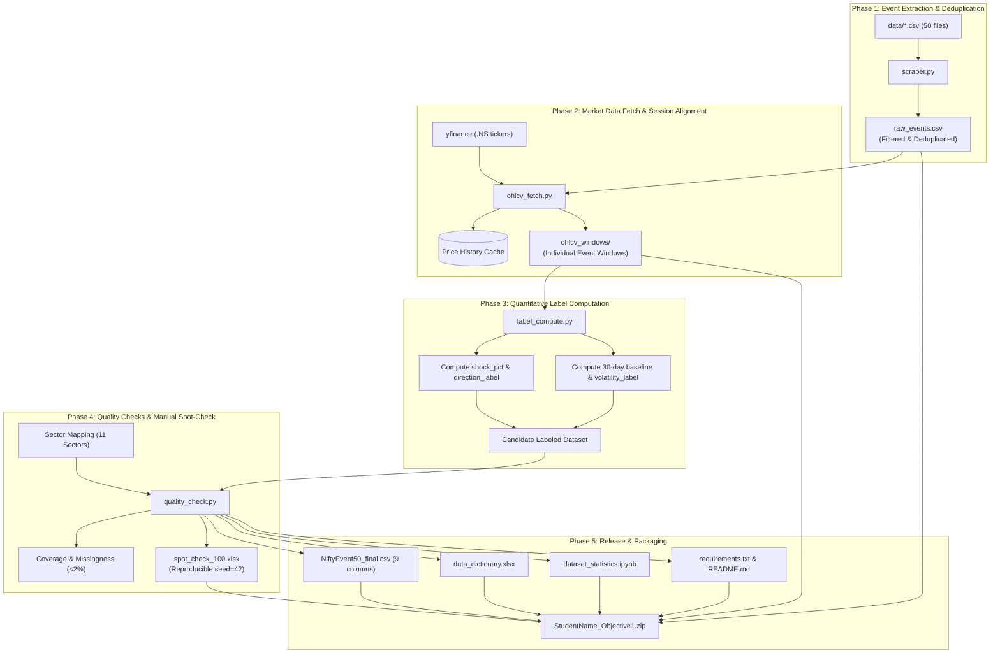

# NiftyEvent-50: Implementation Phases & Execution Plan

This document details the step-by-step implementation phases for constructing the **NiftyEvent-50** dataset (Objective 1), following the approved requirements in [`NiftyEvent50_PRD.md`](file:///c:/Users/ronad/OneDrive/Desktop/Projects/major-project/context/NiftyEvent50_PRD.md), the system design in [`Architecture.md`](file:///c:/Users/ronad/OneDrive/Desktop/Projects/major-project/context/Architecture.md), and the frozen rules in [`decisions.md`](file:///c:/Users/ronad/OneDrive/Desktop/Projects/major-project/context/decisions.md).

---

## Phase 1: Event Ingestion & Deduplication (`scraper.py` $\rightarrow$ `raw_events.csv`)

### Objectives
Extract corporate announcements from the 50 company files in [`data/`](file:///c:/Users/ronad/OneDrive/Desktop/Projects/major-project/data), filter strictly to the 2018–2024 timeframe and the 5 approved corporate event types, split composite filings, deduplicate within $\pm 2$ days, and assign stable internal event IDs.

### Input Data
* 50 CSV files located in `data/` (`1-AXISBANK.csv` through `50-ULTRACEMCO.csv`).
* Columns: `SYMBOL`, `COMPANY NAME`, `SUBJECT`, `DETAILS`, `BROADCAST DATE/TIME`, `RECEIPT`, `DISSEMINATION`, `DIFFERENCE`, `ATTACHMENT`.

### Processing Steps & Logic
1. **Datetime Parsing & Period Filtering:**
   * Parse `BROADCAST DATE/TIME` (accounting for formats such as `DD-Mon-YYYY HH:MM:SS`).
   * Filter strictly to $2018 \le \text{year} \le 2024$ (discarding pre-2018 and post-2024 announcements).
2. **Event Taxonomy Classification (5 Types):**
   * **Dividend Declaration:** Detect `dividend` in `SUBJECT` or `DETAILS`.
   * **Bonus Issue:** Detect `bonus` in `SUBJECT` or `DETAILS` (excluding ESOP/options).
   * **Stock Split:** Detect `split`, `sub-division`, `sub division`, or `subdivision`.
   * **Earnings Surprise (Beat/Miss):** Detect `financial result`, `quarterly result`, `audited financial`, or `unaudited financial`.
   * **Management Change:** Detect `appointment`, `resignation`, `cessation`, `re-appointment`, or `change in management` involving directors, CEOs, CFOs, MDs, or KMPs.
3. **Multi-Event Splitting:**
   * If a single board meeting filing announces both Financial Results and Dividend (or Bonus), generate **two distinct event records** with the same timestamp.
4. **$\pm 2$-Day Window Deduplication:**
   * Group by `(ticker, event_type)`.
   * Sort by timestamp and drop duplicate announcements that occur within $\pm 2$ days of an earlier announcement for the same ticker and event type.
5. **Event Identifier Assignment:**
   * Assign a stable, sequential ID: `EVT_0001`, `EVT_0002`, ..., `EVT_3441`.

### Deliverables of Phase 1
* [`scraper.py`](file:///c:/Users/ronad/OneDrive/Desktop/Projects/major-project/scraper.py): CLI script with reproducible execution.
* [`raw_events.csv`](file:///c:/Users/ronad/OneDrive/Desktop/Projects/major-project/raw_events.csv): Master filtered event catalog containing `event_id`, `ticker`, `company_name`, `date`, `broadcast_datetime`, `event_type`, `subject`, `details`, and `attachment_url`.

---

## Phase 2: Market Data Windows & Session Alignment (`ohlcv_fetch.py` $\rightarrow$ `ohlcv_windows/`)

### Objectives
Retrieve adjusted historical price data for all 50 tickers using `yfinance`, apply the $T_0$ trading session alignment rule for after-hours/weekend announcements, extract the 3 prior and 5 subsequent trading sessions, and compute pre/post-event average prices.

### Processing Steps & Logic
1. **Ticker History Ingestion & Local Caching:**
   * Download full daily price history (2017–2025) for each ticker using `.NS` suffix via `yfinance`.
   * Cache full price history to disk (`cache/price_history_{ticker}.csv`) to avoid repeated network requests and rate limits.
   * Use **Adjusted Close (`Adj Close`)** for all price and return calculations to eliminate artificial splits/bonus distortions.
2. **Trading Session Alignment ($T_0$ Rule):**
   * If broadcast Mon–Fri between **09:15 and 15:30 IST**: $T_0 = \text{Announcement Date}$.
   * If broadcast Mon–Fri **after 15:30 IST** or **before 09:15 IST**: $T_0 = \text{Next active NSE trading day}$.
   * If broadcast on a **weekend or exchange holiday**: $T_0 = \text{Next active NSE trading day}$.
3. **Window Extraction (3 Prior + 5 Subsequent Sessions):**
   * Locate index of $T_0$ in the stock's active trading calendar.
   * Extract **3 trading days before**: $T_{-3}, T_{-2}, T_{-1}$.
   * Extract **5 trading days after**: $T_{+1}, T_{+2}, T_{+3}, T_{+4}, T_{+5}$.
   * Exclude day $T_0$ from both average price calculations to avoid intra-day price spillover.
4. **Missing Sessions & Forward-Fill Policy:**
   * Forward-fill allowed for at most 1 missing trading session within the window.
   * If $\ge 2$ sessions are missing across the 8-day window, mark as invalid and record in `retrieval_failures.csv`.
5. **Window Price Averages:**
   $$\text{pre\_event\_price} = \frac{\sum_{i=1}^{3} P_{T-i}}{3}, \quad \text{post\_event\_price} = \frac{\sum_{j=1}^{5} P_{T+j}}{5}$$
6. **Per-Event Window Persistence:**
   * Save each extracted 8-session window into `ohlcv_windows/{event_id}_{ticker}.csv`.

### Deliverables of Phase 2
* [`ohlcv_fetch.py`](file:///c:/Users/ronad/OneDrive/Desktop/Projects/major-project/ohlcv_fetch.py): Market data retrieval and session alignment script.
* `ohlcv_windows/`: Folder containing individual OHLCV event window CSVs.
* `reports/retrieval_failures.csv`: Log of any failed/excluded tickers or incomplete windows.

---

## Phase 3: Quantitative Label Computation (`label_compute.py`)

### Objectives
Compute the percentage price shock, classify directional movement (`Up`, `Down`, `Neutral`), calculate historical rolling 30-day baseline volatility and event-window volatility, and flag volatility spikes.

### Processing Steps & Logic
1. **Price Shock Percentage Calculation:**
   $$\text{shock\_pct} = \left(\frac{\text{post\_event\_price} - \text{pre\_event\_price}}{\text{pre\_event\_price}}\right) \times 100$$
   * Formatted to 2 decimal places. Zero or negative pre-event price flagged as invalid.
2. **Directional Label Assignment:**
   $$\text{direction\_label} = \begin{cases} \text{Up}, & \text{if } \text{shock\_pct} > +0.5\% \\ \text{Down}, & \text{if } \text{shock\_pct} < -0.5\% \\ \text{Neutral}, & \text{if } -0.5\% \le \text{shock\_pct} \le +0.5\% \end{cases}$$
3. **Volatility Baseline & Spike Labeling:**
   * Daily return series: $R_t = \frac{P_t - P_{t-1}}{P_{t-1}}$.
   * **Baseline Volatility ($\sigma_{\text{baseline}}$):** Rolling 30-trading-day standard deviation over the window strictly preceding the event ($T_{-33}$ to $T_{-4}$), ensuring zero look-ahead bias.
   * **Window Volatility ($\sigma_{\text{window}}$):** Sample standard deviation of daily returns across the 8-day event window ($T_{-3}$ to $T_{+5}$).
   * **Volatility Spike Flag:**
     $$\text{volatility\_label} = \begin{cases} \text{Yes}, & \text{if } \sigma_{\text{window}} > 1.5 \times \sigma_{\text{baseline}} \\ \text{No}, & \text{otherwise} \end{cases}$$
4. **Candidate Dataset Joining:**
   * Join calculated metrics with event metadata on `event_id`.

### Deliverables of Phase 3
* [`label_compute.py`](file:///c:/Users/ronad/OneDrive/Desktop/Projects/major-project/label_compute.py): Label calculation script with reproducible CLI commands.
* `candidate_labeled_events.csv`: Intermediate table with all internal calculations, prices, returns, and flags.

---

## Phase 4: Sector Mapping, Quality Assurance & Spot Check (`quality_check.py`)

### Objectives
Map all 50 tickers to the 11 approved NSE sectors, validate schema integrity, audit missingness and coverage, and generate a reproducible 100-event random spot-check workbook.

### Processing Steps & Logic
1. **Sector Mapping:**
   * Map each ticker symbol to its approved sector: `IT`, `Banking`, `Energy`, `FMCG`, `Auto`, `Pharma`, `Metal`, `Realty`, `Telecom`, `Finance`, `Infra`.
   * Formally verify that 10 sectors have active constituents and document 0 constituents for `Realty`.
2. **Missingness & Completeness Audits:**
   * Audit column-level missing values (enforce $< 2\%$ threshold).
   * Flag any individual row with $> 2$ missing attributes.
3. **Reproducible 100-Event Random Sample:**
   * Use pseudo-random sampling with a fixed seed (`seed = 42`).
   * Stratify sample across event types and years where possible.
4. **Manual Spot-Check Workbook Generation (`spot_check_100.xlsx`):**
   * Populate 100 sample events with event date, ticker, sector, event type, pre-price, post-price, shock %, direction label, volatility label.
   * Provide verification audit columns: `verified_event_date`, `verified_prices`, `verified_labels`, `verification_status` (`Correct`/`Incorrect`), `notes`.
   * Compute verified accuracy score (target $\ge 90\%$).

### Deliverables of Phase 4
* [`quality_check.py`](file:///c:/Users/ronad/OneDrive/Desktop/Projects/major-project/quality_check.py): QA audit and validation script.
* [`spot_check_100.xlsx`](file:///c:/Users/ronad/OneDrive/Desktop/Projects/major-project/spot_check_100.xlsx): 100-event verification workbook with accuracy scoring.
* `reports/quality_report.csv` and `reports/coverage_report.csv`.

---

## Phase 5: Final Release & Submission Packaging

### Objectives
Export the final release-grade CSV matching the 9-column schema, generate the data dictionary, compile the statistics notebook, document reproducibility, and package the complete submission archive.

### Deliverables & Output Layout
1. **[`NiftyEvent50_final.csv`](file:///c:/Users/ronad/OneDrive/Desktop/Projects/major-project/NiftyEvent50_final.csv):**
   Strict 9-column release format:
   `date`, `ticker`, `sector`, `event_type`, `pre_event_price`, `post_event_price`, `shock_pct`, `volatility_label`, `direction_label`.
2. **[`data_dictionary.xlsx`](file:///c:/Users/ronad/OneDrive/Desktop/Projects/major-project/data_dictionary.xlsx):**
   Full schema documentation: column names, data types, value sets, formulas, thresholds, and missingness rules.
3. **[`dataset_statistics.ipynb`](file:///c:/Users/ronad/OneDrive/Desktop/Projects/major-project/dataset_statistics.ipynb):**
   Jupyter notebook generating coverage breakdowns:
   * Event count by sector, by event type, and by year (2018–2024).
   * Direction label distributions (`Up`, `Down`, `Neutral`) and volatility spike frequencies.
   * Visual charts and missingness heatmaps.
4. **[`requirements.txt`](file:///c:/Users/ronad/OneDrive/Desktop/Projects/major-project/requirements.txt):**
   Pinned Python dependencies (`pandas`, `numpy`, `yfinance`, `openpyxl`, `matplotlib`, `seaborn`, `jupyter`).
5. **[`README.md`](file:///c:/Users/ronad/OneDrive/Desktop/Projects/major-project/README.md):**
   Comprehensive setup guide, methodology, command-line instructions, limitations, and data provenance.
6. **Submission Archive (`StudentName_Objective1.zip`):**
   Consolidated zipped package containing all required submission components.

---

## Phase Verification Gates

| Gate | Criterion | Target | Verification Check |
| :--- | :--- | :--- | :--- |
| **Gate 1** | Total labeled events | $\ge 3,000$ | Row count in `raw_events.csv` and `NiftyEvent50_final.csv` |
| **Gate 2** | Stock coverage | 50 companies | Distinct `ticker` count = 50 |
| **Gate 3** | Column missingness | $< 2\%$ | Null count per column in `NiftyEvent50_final.csv` |
| **Gate 4** | Verification accuracy | $\ge 90\%$ | Correct verification count in `spot_check_100.xlsx` |
| **Gate 5** | Clean execution | 100% | Pipeline runs end-to-end from clean environment |
